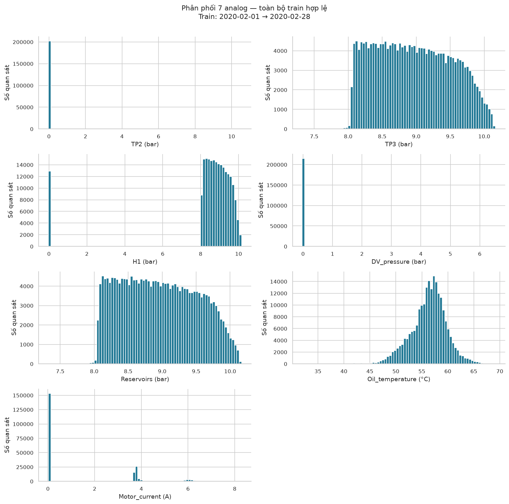
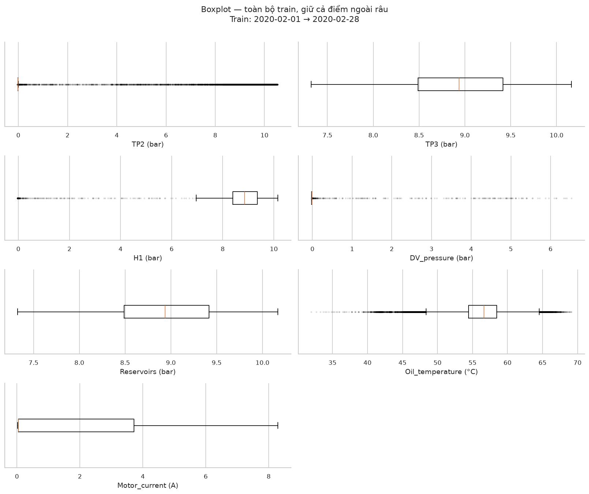
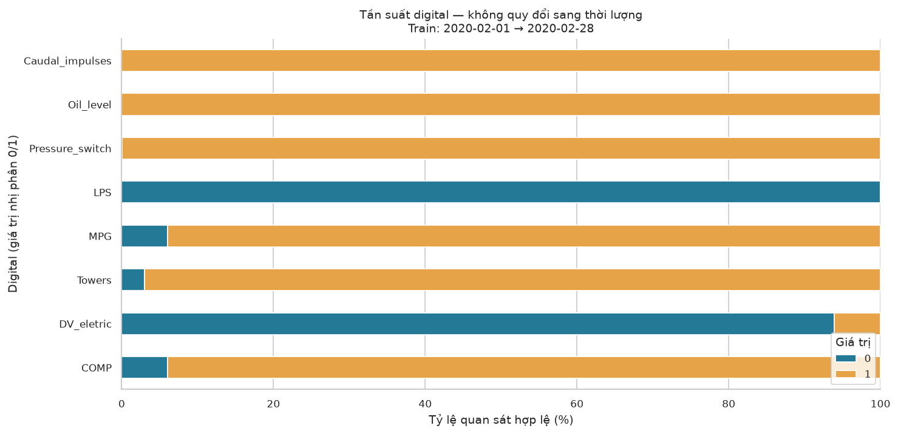
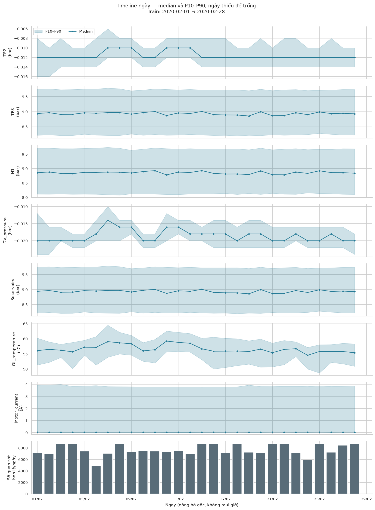
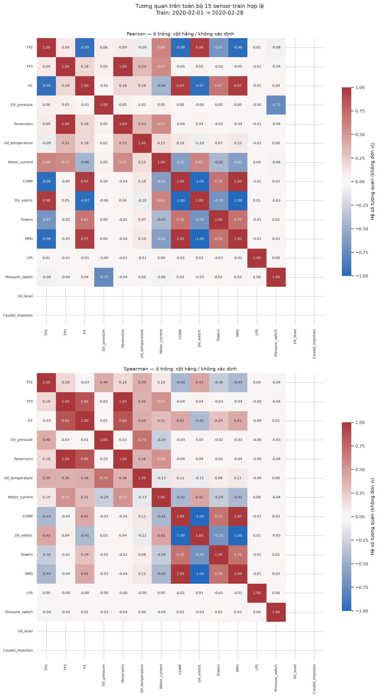
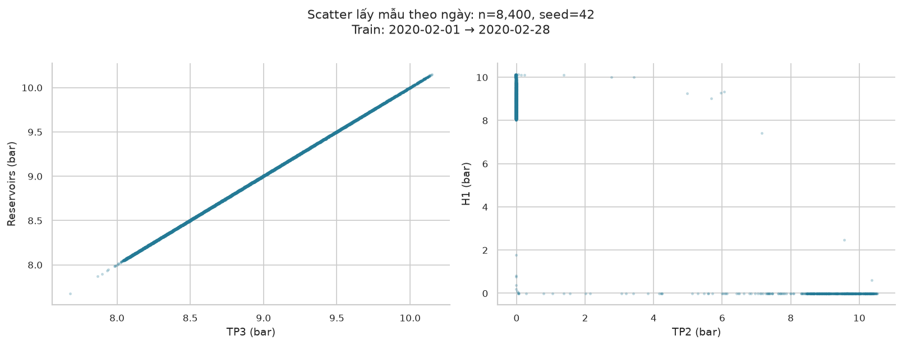
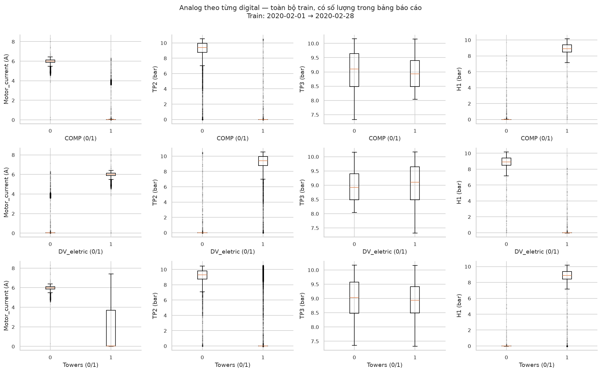
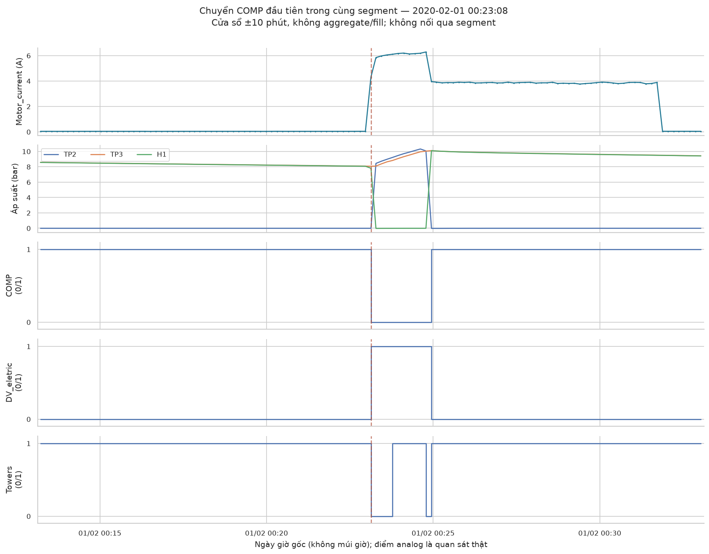
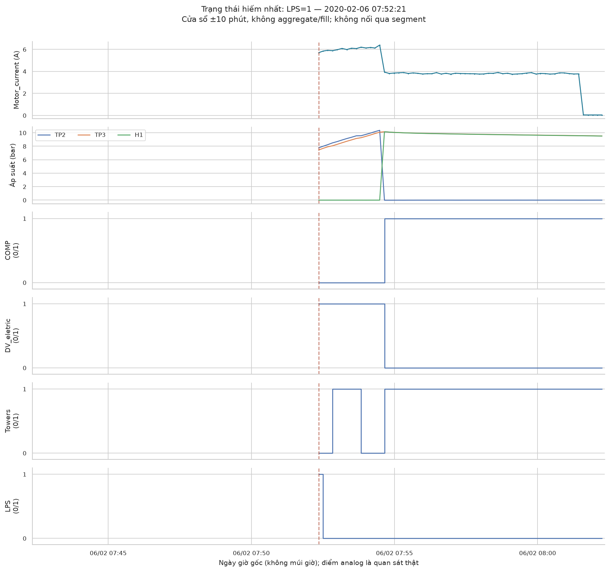

# PB06 — Khám phá dữ liệu train MetroPT-3

Mục tiêu: hiểu phân phối, biến động theo thời gian và quan hệ giữa các tín hiệu trước khi xây detector. Mọi số liệu và lựa chọn đoạn minh họa dưới đây chỉ dùng train; chưa có kết quả huấn luyện hay chấm điểm bất thường.

## 1. Những điểm đáng chú ý

TP3 và Reservoirs gần trùng nhau: Pearson=0.999991, Spearman=0.999992. Đây là bằng chứng về mức độ trùng thông tin trên train, chưa phải quyết định bỏ cột.

TP2 và H1 có Pearson=-0.950773, nhưng Spearman=-0.030357. Hai chỉ số khác nhau mạnh; cần đọc cùng scatter và trạng thái digital, thay vì mô tả chúng bằng một quan hệ đơn điệu duy nhất.

Motor_current khác rõ theo COMP: median khi COMP=0 là 6.0050 A; khi COMP=1 là 0.0375 A. Một ngưỡng duy nhất trên dữ liệu trộn trạng thái có thể phản ánh khác biệt chế độ; đây là giả thuyết cần kiểm tra sau này.

Digital hằng trên train: Oil_level=1, Caudal_impulses=1. Chưa có bằng chứng từ train về hành vi ở giá trị còn lại; báo cáo không sửa schema hay feature.

Trạng thái ít quan sát nhất là LPS=1: 1 dòng (0.000465%). Tần suất hiếm không tự chứng minh lỗi; xem đoạn chi tiết và giới hạn nhãn ở cuối báo cáo.

## 2. Phạm vi dữ liệu và chất lượng

| Thông tin | Giá trị |
| --- | --- |
| Đầu vào | data/interim/pb05-verified-20261025/cleaned.parquet |
| Dataset version | sha256-978c4a95ef411383efe6bb86e35496d632fb23e6456b0a56973513e76c722c55 |
| CSV SHA-256 | db30ccb4ea402e3c8bf2c99db06e288d4f2a772f6928f9dbe26a920d69793e24 |
| Config hash | 5682fdfd2397ea08bf85dd24e85921b3693b9b33012c16ffe561002b991a881b |
| Train kết thúc trước | 2020-03-01 00:00:00 |
| Khoảng quan sát hợp lệ | 2020-02-01 00:00:00 → 2020-02-28 23:57:08 |
| Dòng train trước quality mask | 214850 |
| Dòng bị loại do valid=false/null | 0 |
| Dòng train dùng phân tích | 214850 |
| Số segment có quan sát hợp lệ | 36 |
| Nhịp mode từ train (giây) | 10 |
| Ngưỡng gap: delta > (giây) | 30 |
| Số gap trong train trước quality mask | 35 |

| Quality flag trong cleaned train | Số dòng (có thể chồng lấp) |
| --- | --- |
| invalid_timestamp | 0 |
| missing_cell | 0 |
| invalid_numeric | 0 |
| infinity | 0 |
| invalid_digital | 0 |

Quality mask dùng cột valid của PB03; không fill và không xóa analog âm hoặc cực trị hợp lệ. Những dòng đã bị audit loại vì timestamp lỗi/trùng/xung đột không có trong cleaned: xem data card PB03/PB05 cho sổ audit toàn nguồn. Báo cáo này chỉ đếm quality flags còn trong cleaned train.

Đơn vị analog: áp suất bar, nhiệt độ °C, dòng điện A; digital là giá trị nhị phân không đơn vị. Nguồn đơn vị: [UCI MetroPT-3 — bảng biến](https://archive.ics.uci.edu/dataset/791/metropt%2B3%2Bdataset). Đồng hồ timestamp gốc không có múi giờ. Tần suất là tỷ lệ theo quan sát, không phải phần trăm thời gian do nhịp không hoàn toàn đều và có gap.

EDA mô tả các quan sát cảm biến hợp lệ, nên không áp warm-up/purge của lưới cửa sổ PB05 lên raw. temporal_valid trong minute_grid là điều kiện thời gian cho mốc chấm điểm, không phải quality mask của dòng raw; validity cuối cùng của feature thuộc PB07.

## 3. Phân phối 7 analog

| sensor | unit | count | mean | std | min | 1% | 25% | 50% | 75% | 99% | max |
| --- | --- | --- | --- | --- | --- | --- | --- | --- | --- | --- | --- |
| TP2 | bar | 214,850 | 0.537803 | 2.197691 | -0.03 | -0.022 | -0.012 | -0.012 | -0.01 | 10.128 | 10.544 |
| TP3 | bar | 214,850 | 8.962042 | 0.552074 | 7.324 | 8.066 | 8.488 | 8.936 | 9.414 | 10.05 | 10.164 |
| H1 | bar | 214,850 | 8.398003 | 2.199217 | -0.03 | -0.022 | 8.39 | 8.856 | 9.352 | 10.024 | 10.158 |
| DV_pressure | bar | 214,850 | -0.015622 | 0.104783 | -0.028 | -0.024 | -0.02 | -0.018 | -0.016 | -0.012 | 6.53 |
| Reservoirs | bar | 214,850 | 8.964114 | 0.55151 | 7.326 | 8.068 | 8.49 | 8.938 | 9.416 | 10.05 | 10.168 |
| Oil_temperature | °C | 214,850 | 56.309574 | 3.41319 | 31.975 | 47.425 | 54.425 | 56.625 | 58.475 | 64.175 | 69.15 |
| Motor_current | A | 214,850 | 1.245202 | 1.962112 | 0.02 | 0.0325 | 0.0375 | 0.0375 | 3.715 | 6.1675 | 8.2925 |

std trong bảng dùng ddof=1 theo describe của pandas và chỉ phục vụ EDA; công thức feature PB07 vẫn theo config. Histogram dùng 80 bin trên toàn bộ train hợp lệ, không cắt miền; các đuôi rất ít quan sát có thể khó nhìn ở thang đếm tuyến tính. Boxplot dùng râu 1,5×IQR; điểm ngoài râu chỉ là mô tả thống kê.

Histogram của toàn bộ 7 analog trên train hợp lệ.

Boxplot cùng miền giá trị đầy đủ, giữ điểm cực trị.

Motor_current có median=0.0375 A, Q3=3.7150 A và P99=6.1675 A: phần lớn quan sát ở mức thấp nhưng có một nhóm mức cao. TP2 có median=-0.0120 bar và P99=10.1280 bar. Các phân phối trộn mức này cần được đối chiếu với digital.

DV_pressure có P99=-0.0120 bar nhưng max=6.5300 bar: tồn tại đuôi dương ít quan sát. Chưa có căn cứ để loại các giá trị đó hoặc gọi là lỗi cảm biến.

## 4. Tín hiệu digital và trạng thái hiếm

| sensor | value | count | percent |
| --- | --- | --- | --- |
| COMP | 0 | 13031 | 6.065162 |
| COMP | 1 | 201819 | 93.934838 |
| DV_eletric | 0 | 201817 | 93.933907 |
| DV_eletric | 1 | 13033 | 6.066093 |
| Towers | 0 | 6502 | 3.026297 |
| Towers | 1 | 208348 | 96.973703 |
| MPG | 0 | 13031 | 6.065162 |
| MPG | 1 | 201819 | 93.934838 |
| LPS | 0 | 214849 | 99.999535 |
| LPS | 1 | 1 | 0.000465 |
| Pressure_switch | 0 | 163 | 0.075867 |
| Pressure_switch | 1 | 214687 | 99.924133 |
| Oil_level | 0 | 0 | 0 |
| Oil_level | 1 | 214850 | 100 |
| Caudal_impulses | 0 | 0 | 0 |
| Caudal_impulses | 1 | 214850 | 100 |

Tỷ lệ từng giá trị 0/1 của 8 digital; bảng phía trên giữ số đếm chính xác cho trạng thái rất hiếm.

COMP và MPG bằng nhau ở 100.000000% quan sát train; COMP và DV_eletric khác nhau ở 99.999069%. Các tỷ lệ này là quan sát trên train, không phải quy luật chắc chắn cho dữ liệu mới.

LPS=1: 1 dòng, từ 2020-02-06 07:52:21 đến 2020-02-06 07:52:21. Hai mốc chỉ là đầu/cuối quan sát, không khẳng định trạng thái kéo dài liên tục.

Pressure_switch=0: 163 dòng, từ 2020-02-01 02:05:42 đến 2020-02-28 22:59:58. Hai mốc chỉ là đầu/cuối quan sát, không khẳng định trạng thái kéo dài liên tục.

## 5. Xu hướng và độ phủ theo ngày

Mỗi ngày: median và dải P10–P90, tính từ tất cả quan sát hợp lệ; không nội suy ngày thiếu.

Median Oil_temperature theo ngày nằm trong 54.550–59.250 °C; thấp nhất ngày 24/02/2020, cao nhất ngày 12/02/2020. Các median tăng/giảm theo từng đoạn; biểu đồ mô tả biến động, chưa đủ để kết luận có xu hướng suy giảm thiết bị hay chu kỳ ổn định.

Ngày không có dòng hợp lệ trong lịch train: 29/02/2020. Ngày ít quan sát có thể có phân phối khác do thiếu một phần trạng thái; không so median mà bỏ qua số dòng.

| day | valid_rows | Oil_temperature_median | Motor_current_median | TP3_median |
| --- | --- | --- | --- | --- |
| 2020-02-01 00:00:00 | 7144 | 56.075 | 0.04 | 8.938 |
| 2020-02-02 00:00:00 | 7031 | 56.525 | 0.0375 | 8.968 |
| 2020-02-03 00:00:00 | 8716 | 56.225 | 0.0375 | 8.91 |
| 2020-02-04 00:00:00 | 8717 | 55.7 | 0.0375 | 8.914 |
| 2020-02-05 00:00:00 | 7437 | 57.225 | 0.0375 | 8.964 |
| 2020-02-06 00:00:00 | 4939 | 57.2 | 0.0375 | 8.95 |
| 2020-02-07 00:00:00 | 7052 | 59.075 | 0.0375 | 8.97 |
| 2020-02-08 00:00:00 | 8689 | 58.675 | 0.0375 | 8.972 |
| 2020-02-09 00:00:00 | 7279 | 58.375 | 0.0375 | 8.918 |
| 2020-02-10 00:00:00 | 7468 | 56 | 0.0375 | 8.972 |
| 2020-02-11 00:00:00 | 7431 | 56.4 | 0.0375 | 9.006 |
| 2020-02-12 00:00:00 | 7353 | 59.25 | 0.035 | 8.872 |
| 2020-02-13 00:00:00 | 7528 | 58.825 | 0.035 | 8.959 |
| 2020-02-14 00:00:00 | 6932 | 58.525 | 0.035 | 8.94 |
| 2020-02-15 00:00:00 | 8716 | 56.7 | 0.0375 | 9.009 |
| 2020-02-16 00:00:00 | 8716 | 55.9 | 0.0375 | 8.904 |
| 2020-02-17 00:00:00 | 7095 | 55.925 | 0.0375 | 8.892 |
| 2020-02-18 00:00:00 | 8716 | 55.975 | 0.04 | 8.89 |
| 2020-02-19 00:00:00 | 7225 | 55.8 | 0.0375 | 8.858 |
| 2020-02-20 00:00:00 | 7113 | 56.6 | 0.0375 | 8.998 |
| 2020-02-21 00:00:00 | 8716 | 55.4 | 0.04 | 8.866 |
| 2020-02-22 00:00:00 | 8716 | 56.5 | 0.04 | 8.872 |
| 2020-02-23 00:00:00 | 7105 | 56.725 | 0.0375 | 8.966 |
| 2020-02-24 00:00:00 | 5893 | 54.55 | 0.0375 | 8.902 |
| 2020-02-25 00:00:00 | 8716 | 55.8 | 0.04 | 8.992 |
| 2020-02-26 00:00:00 | 7244 | 55.825 | 0.0375 | 8.938 |
| 2020-02-27 00:00:00 | 8464 | 55.8 | 0.04 | 8.948 |
| 2020-02-28 00:00:00 | 8699 | 55.4 | 0.04 | 8.93 |
| 2020-02-29 00:00:00 | 0 | — | — | — |

Train có 35 gap dài hơn 30 giây; gap dài nhất là 28,714 giây. Tổng số mẫu không chứng minh độ phủ liên tục. Danh sách gap được lưu ở tables/train_gaps.csv.

## 6. Tương quan và giới hạn diễn giải

Pearson và Spearman của toàn bộ 15 sensor; cột hằng có tương quan không xác định, để trống.

| sensor_1 | sensor_2 | Pearson | Spearman |
| --- | --- | --- | --- |
| TP3 | Reservoirs | 0.999991 | 0.999992 |
| TP2 | H1 | -0.950773 | -0.030357 |
| TP3 | H1 | 0.182122 | 0.856648 |
| TP2 | Motor_current | 0.604948 | 0.103462 |
| Oil_temperature | DV_pressure | 0.018189 | 0.698341 |
| COMP | MPG | 1 | 1 |

Scatter minh họa hai cặp áp suất; lấy mẫu riêng từng ngày, không dùng sample để tính tương quan.

Pearson nhạy với biên độ và các nhóm mức cách xa nhau; Spearman dùng thứ hạng và xử lý ties bằng thứ hạng trung bình. Với TP2/H1, nhóm trạng thái khác nhau có thể chi phối Pearson trong khi thứ hạng bên trong các nhóm có hành vi khác. Đây là giả thuyết từ scatter, cần phân tích theo trạng thái nếu mở rộng.

Chuỗi thời gian có phụ thuộc giữa các dòng; đây không phải kiểm định với các quan sát độc lập. Tương quan không xác nhận nhân quả hay cảm biến dư thừa trong mọi chế độ. Không tính p-value, không tự loại cột và không diễn giải ô trống của cột hằng thành tương quan bằng 0.

## 7. Đối chiếu analog với COMP / DV_eletric / Towers

| signal | value | count | percent | Motor_current_median | TP2_median | TP3_median | H1_median | DV_pressure_median |
| --- | --- | --- | --- | --- | --- | --- | --- | --- |
| COMP | 0 | 13031 | 6.065162 | 6.005 | 9.392 | 9.106 | -0.014 | -0.018 |
| COMP | 1 | 201819 | 93.934838 | 0.0375 | -0.012 | 8.928 | 8.912 | -0.018 |
| DV_eletric | 0 | 201817 | 93.933907 | 0.0375 | -0.012 | 8.928 | 8.912 | -0.018 |
| DV_eletric | 1 | 13033 | 6.066093 | 6.005 | 9.39 | 9.106 | -0.014 | -0.018 |
| Towers | 0 | 6502 | 3.026297 | 5.985 | 9.294 | 9.036 | -0.014 | -0.018 |
| Towers | 1 | 208348 | 96.973703 | 0.0375 | -0.012 | 8.934 | 8.884 | -0.018 |

Boxplot analog theo từng giá trị digital; dữ liệu đầy đủ, không cân bằng lại tỷ lệ nhóm.

| COMP | DV_eletric | Towers | count | percent |
| --- | --- | --- | --- | --- |
| 0 | 1 | 0 | 6502 | 3.026297 |
| 0 | 1 | 1 | 6529 | 3.038864 |
| 1 | 0 | 1 | 201817 | 93.933907 |
| 1 | 1 | 1 | 2 | 0.000931 |

Ba digital này phụ thuộc mạnh vào nhau trên train, nên khác biệt khi nhóm riêng theo Towers không chứng minh Towers gây thay đổi dòng điện. Báo cáo dùng COMP=0/1, DV_eletric=0/1, Towers=0/1 làm tên trạng thái; không gán tên cơ học chỉ từ giá trị.

Đoạn ±10 phút quanh chuyển COMP đầu tiên có hai quan sát liên tiếp cùng segment. Digital vẽ step để minh họa, không dùng làm dữ liệu fill.

Đoạn ±10 phút quanh quan sát đầu tiên của trạng thái digital có số đếm dương nhỏ nhất; hòa chọn theo tên cột rồi giá trị.

## 8. Cách chạy lại và giới hạn kết luận

Seed=42; mỗi ngày lấy tối đa 300 quan sát hợp lệ không hoàn lại bằng numpy.default_rng, duyệt ngày tăng dần và dữ liệu sắp theo timestamp/raw_row_id. Sample có 8,400 dòng trên 28 ngày có quan sát. Bảng sampling_by_day.csv lưu số lượng từng ngày; code đủ để dựng lại cùng sample, không cần manifest ID.

Thống kê, histogram, boxplot, tương quan và bảng trạng thái dùng toàn bộ train hợp lệ. Chỉ scatter dùng sample. Timeline ngày aggregate để vẽ; chi tiết dùng raw. Không đưa bảng aggregate/sample của báo cáo vào pipeline feature.

Chạy từ root repo: .\.venv\Scripts\python.exe scripts/pb06_train_eda.py --config configs/base.yaml --cleaned data/interim/pb05-verified-20261025/cleaned.parquet --output docs/examples/pb06

Script: scripts/pb06_train_eda.py. Bảng máy đọc: tables/*.csv. provenance.json ghi dữ liệu, config và phiên bản thư viện. Báo cáo HTML nhúng toàn bộ ảnh nên có thể mở độc lập; Markdown tham chiếu thư mục figures/.

Train chỉ bao phủ tháng đầu và không có sự cố được báo cáo trong giai đoạn này theo events.csv của PB04; ngoài khoảng sự cố không đồng nghĩa được xác nhận hoàn toàn khỏe. EDA chưa chứng minh khả năng phát hiện sự cố. Không dùng validation/test để chọn nhận xét, sample, cửa sổ minh họa hoặc sửa feature. PCA/K-Means, fit preprocessing và mô hình được thực hiện ở các PB tiếp theo.
